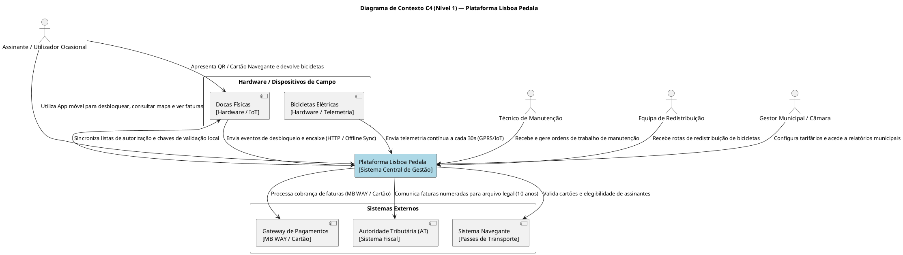
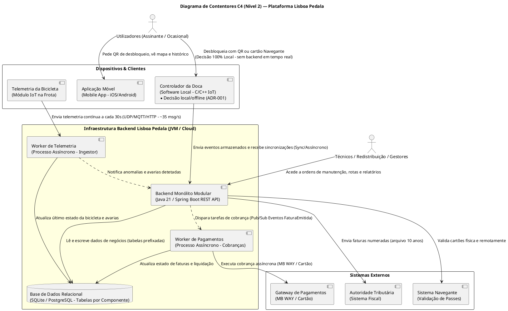
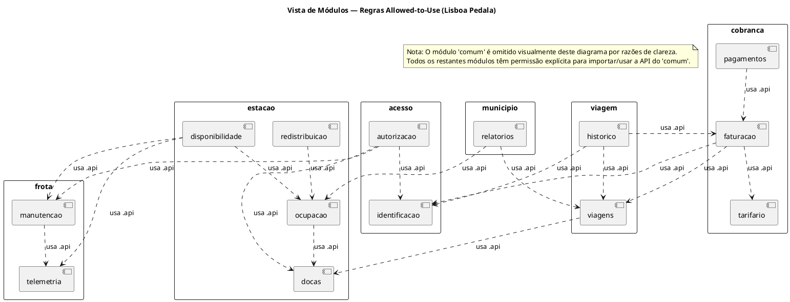
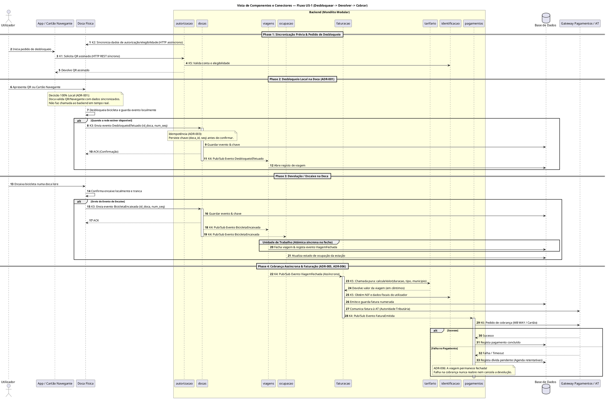

# ARCHITECTURE.md — Guia de Arquitetura e Especificação para Geração de Código

Este documento especifica a arquitetura da plataforma **Lisboa Pedala** de forma estruturada e exaustiva, servindo de especificação direta para ferramentas de IA (ou programadores) gerarem o esqueleto de código funcional em Java 21 com Spring Boot e ArchUnit.

---

## 1. Visão Geral da Plataforma

A plataforma **Lisboa Pedala** é um sistema de micro-mobilidade de bicicletas elétricas partilhadas. A arquitetura foi desenhada como um **Monólito Modular** (particionado por domínio), garantindo elevado desempenho, facilidade de manutenção e desacoplamento temporal.

### Top 3 Características Arquiteturais Norteadoras:
1. **C1 — Disponibilidade (Operacional/Implícita):** O desbloqueio de bicicletas é decidido 100% localmente na doca física (sem dependência do backend em tempo real). Eventos reenviados após falhas de rede são processados de forma estritamente idempotente.
2. **C2 — Elasticidade (Operacional/Implícita):** A receção de telemetria contínua (~35 msg/s das 1 050 bicicletas) e as consultas de leitura do mapa são isoladas da escrita transacional de viagens e ocupação.
3. **C3 — Configurabilidade (Estrutural/Implícita):** O cálculo do valor das viagens é uma função pura e configurável por município, isolada da lógica legal e fiscal de faturação.

---

## 2. Estrutura de Pacotes (Tree View)

A implementação segue rigorosamente o particionamento por domínio. Os pacotes de primeiro nível representam os **Domínios de Negócio** e os pacotes de segundo nível representam os **Componentes Lógicos (nós-folha)**.

Cada componente lógico possui um subpacote obrigatório `.api` (interfaces, DTOs e eventos públicos). Tudo o que estiver fora do `.api` é implementação privada do componente.

```text
src/main/java/pt/lisboapedala/
├── comum/                           # Tipos simples, ID, Montante, EventoBase (SEM lógica de negócio)
├── acesso/
│   ├── identificacao/               # identificacao.api (interfaces/DTOs), identificacao.internal (autenticação, elegibilidade)
│   └── autorizacao/                 # autorizacao.api, autorizacao.internal (emissão de QR assinados, sincronização)
├── estacao/
│   ├── docas/                       # docas.api, docas.internal (receção fiável de eventos, idempotência, deduplicação)
│   ├── ocupacao/                    # ocupacao.api, ocupacao.internal (escrita transacional de ocupação por estação)
│   ├── disponibilidade/             # disponibilidade.api, disponibilidade.internal (vista de leitura em cache do mapa)
│   └── redistribuicao/              # redistribuicao.api, redistribuicao.internal (sugestão de rotas de reequilíbrio)
├── viagem/
│   ├── viagens/                     # viagens.api, viagens.internal (ciclo de vida: abertura no desbloqueio e fecho atómico no encaixe)
│   └── historico/                   # historico.api, historico.internal (consultas do próprio utilizador: viagens e faturas)
├── cobranca/
│   ├── tarifario/                   # tarifario.api, tarifario.internal (função pura: cálculo de preço por município)
│   ├── faturacao/                   # faturacao.api, faturacao.internal (emissão sequencial de faturas, comunicação AT, arquivo 10 anos)
│   └── pagamentos/                  # pagamentos.api, pagamentos.internal (processamento financeiro assíncrono e retentativas)
├── frota/
│   ├── telemetria/                  # telemetria.api, telemetria.internal (ingestão contínua a 30s, deteção de avarias)
│   └── manutencao/                  # manutencao.api, manutencao.internal (ordens de trabalho e estado fora de serviço)
└── municipio/
    └── relatorios/                  # relatorios.api, relatorios.internal (métricas mensais e CO2 evitado por freguesia)
```

---

## 3. Matriz de Dependências Permetidas (*Allowed-to-Use*)

Cada componente **apenas pode importar ou utilizar** o subpacote `.api` dos componentes listados na sua linha. Qualquer outra importação é uma **violação arquitetural gravíssima**.

| Componente | Dependências Permitidas (`.api`) |
| :--- | :--- |
| `comum` | **Nenhuma** (não importa nenhum outro pacote) |
| `identificacao` | `comum` |
| `autorizacao` | `identificacao.api`, `manutencao.api`, `docas.api`, `comum` |
| `docas` | `comum` |
| `viagens` | `docas.api`, `comum` |
| `ocupacao` | `docas.api`, `comum` |
| `disponibilidade` | `ocupacao.api`, `telemetria.api`, `manutencao.api`, `comum` |
| `telemetria` | `comum` |
| `manutencao` | `telemetria.api`, `comum` |
| `tarifario` | `comum` |
| `faturacao` | `viagens.api`, `tarifario.api`, `identificacao.api`, `comum` |
| `pagamentos` | `faturacao.api`, `comum` |
| `historico` | `viagens.api`, `faturacao.api`, `identificacao.api`, `comum` |
| `redistribuicao` | `ocupacao.api`, `comum` |
| `relatorios` | `viagens.api`, `ocupacao.api`, `comum` |

### Regras de Ocultação de Informação (*Information Hiding*):
1. Um pacote `X` só depende dos pacotes expressamente indicados na tabela.
2. De outro componente, **apenas** se importam classes/interfaces pertencentes ao subpacote `.api`.
3. O pacote `comum` contém apenas VO (*Value Objects*) imutáveis (`Montante`, `DocaId`, `UtilizadorId`) e abstrações de eventos. É estritamente proibido colocar lógica de negócio no `comum`.
4. Ausência absoluta de dependências cíclicas entre pacotes de componentes.
5.  Cada componente é dono exclusivo das suas tabelas na base de dados (prefixo `<componente>_`). NENHUM componente acede diretamente a tabelas de outro componente.

---

## 4. Regras do Fluxo Principal (US-1: Desbloquear → Devolver → Cobrar)

Ao gerar o código para os serviços e event listeners, a IA deve respeitar as seguintes garantias transacionais e assíncronas:

### Phase 1: Desbloqueio Local (ADR-001 & ADR-003)
* `autorizacao` emite QR Code assinado assincronamente e sincroniza dados de elegibilidade com as docas físicas (`K2`).
* A doca autoriza localmente o desbloqueio **sem chamar o backend**.
* Ao reestabelecer rede, a doca envia o evento `DesbloqueioEfetuado(docaId, numSequencia)`.
* `docas` guarda a chave de idempotência `(docaId, numSequencia)` antes de responder com `ACK` e publica o evento ordenado.
* `viagens` consome o evento e abre o registo de viagem.

### Phase 2: Devolução e Unidade de Trabalho Atómica (ADR-003)
* O utilizador encaixa a bicicleta na doca. A doca tranca localmente e envia `BicicletaEncaixada(docaId, numSequencia)`.
* `docas` deduplica o evento e publica-o.
* **Unidade de Trabalho Atómica (Síncrona):** No componente `viagens`, o fecho da viagem e a gravação do evento `ViagemFechada` ocorrem na **mesma transação de base de dados**.
* `ocupacao` reage ao evento e atualiza o estado da estação.

### Phase 3: Cobrança Assíncrona e Faturação (ADR-005 & ADR-006)
* `faturacao` subscreve assincronamente o evento `ViagemFechada`.
* `faturacao` chama `tarifario.api` (função pura) para calcular o preço segundo as regras do município da viagem.
* `faturacao` obtém NIF de `identificacao.api`, grava a fatura numerada e comunica-a simuladamente à Autoridade Tributária (AT).
* `faturacao` publica o evento `FaturaEmitida`.
* `pagamentos` subscreve `FaturaEmitida` e executa a cobrança no gateway simulado (MB WAY / Cartão).
* **Garantia de Desacoplamento (ADR-006):** Se o pagamento falhar, `pagamentos` regista a dívida e agenda retentativas. **A viagem PERMANECE FECHADA e nunca é reaberta nem cancelada.**

---

## 5. Requisitos para Testes de Governação (ArchUnit)

O código gerado deve incluir uma suite de testes de arquitetura com **ArchUnit** em `src/test/java/pt/lisboapedala/architecture/` validando automaticamente:
1. `RegrasAllowedToUseTest`: Garante que nenhum pacote viola a matriz da Secção 3.
2. `ApiPublicaTest`: Garante que nenhuma classe fora de `.api` é importada por componentes externos.
3. `ComumTest`: Garante que `pt.lisboapedala.comum` não importa nenhum pacote do projeto.
4. `SemCiclosTest`: Garante ausência total de ciclos na árvore de dependências.

---

## 6. Referência aos Diagramas da Arquitetura

Para consultar as especificações visuais detalhadas, a IA / programador deve consultar os seguintes ficheiros na pasta `docs/diagramas/`:
* `c4-contexto.puml` / `c4-contexto.svg` — Diagrama de Contexto C4 (Nível 1)
* `c4-contentores.puml` / `c4-contentores.svg` — Diagrama de Contentores C4 (Nível 2)
* `c4-componentes.puml` / `c4-componentes.svg` — Diagrama de Componentes C4 (Nível 3)
* `vista-modulos.puml` / `vista-modulos.svg` — Vista de Módulos (Dependências Estáticas)
* `cc-desbloquear-devolver-cobrar.puml` / `cc-desbloquear-devolver-cobrar.svg` — Vista C&C (Sequência US-1)

---

## 7. Diagramas PlantUML da Arquitetura

### A. C4 Nível 1 — Diagrama de Contexto (`c4-contexto.puml`)


### B. C4 Nível 2 — Diagrama de Contentores (`c4-contentores.puml`)


### C. C4 Nível 3 — Diagrama de Componentes (`c4-componentes.puml`)

```plantuml
@startuml c4-componentes
skinparam componentStyle uml2
skinparam packageStyle rect

title Diagrama de Componentes C4 (Nível 3) — Backend Monólito Modular (Lisboa Pedala)

note "Legenda:\n  ──> Chamada Síncrona a Interface Interna (.api) / REST Externo\n  ..> Evento Assíncrono / Mensagem Pub-Sub Interna\n  Todos os componentes utilizam o pacote partilhado 'comum'." as Legend

package "Dispositivos & Clientes (Externos ao Backend)" #LightGray {
  [Aplicação Móvel / App] as MobileApp
  [Controlador da Doca / Hardware] as DockHW
  [Bicicleta Elétrica / Telemetria] as BikeIoT
}

package "Contentor: Backend Monólito Modular (Java 21 / Spring Boot)" #LightYellow {

  package "Domínio: acesso" {
    [identificacao\n(Autenticação e Elegibilidade)] as CompIdent
    [autorizacao\n(Emissão QR e Sincronização)] as CompAuth
  }

  package "Domínio: estacao" {
    [docas\n(Gestão de Eventos da Doca)] as CompDocas
    [ocupacao\n(Escrita Transacional de Ocupação)] as CompOcupacao
    [disponibilidade\n(Vista de Leitura do Mapa)] as CompDisp
    [redistribuicao\n(Sugestão de Rotas)] as CompRedist
  }

  package "Domínio: viagem" {
    [viagens\n(Ciclo de Vida da Viagem)] as CompViagens
    [historico\n(Consultas de Histórico do Utilizador)] as CompHist
  }

  package "Domínio: cobranca" {
    [tarifario\n(Cálculo de Preço Configurável)] as CompTarif
    [faturacao\n(Emissão e Arquivo de Faturas)] as CompFat
    [pagamentos\n(Processamento Financeiro Assíncrono)] as CompPag
  }

  package "Domínio: frota" {
    [telemetria\n(Ingestão e Deteção de Avarias)] as CompTelem
    [manutencao\n(Ordens de Trabalho dos Técnicos)] as CompManut
  }

  package "Domínio: municipio" {
    [relatorios\n(Métricas Mensais por Freguesia)] as CompRelat
  }

  [comum\n(Tipos e Eventos Partilhados)] as CompComum #LightGray
}

database "Base de Dados Relacional\n(SQLite / PostgreSQL)" as DB

package "Sistemas Externos" {
  [Gateway de Pagamentos\n(MB WAY / Cartão)] as PaymentGW
  [Autoridade Tributária\n(AT)] as ATSystem
  [Sistema Navegante\n(Passes de Transporte)] as NaveganteGW
}

' Relações dos Clientes com Componentes do Backend
MobileApp --> CompAuth : Pede QR assinado
MobileApp --> CompDisp : Consulta mapa em tempo real
MobileApp --> CompHist : Consulta histórico e faturas
DockHW --> CompDocas : Envia eventos de desbloqueio/encaixe
DockHW <-- CompAuth : Recebe dados sincronizados
BikeIoT --> CompTelem : Envia telemetria contínua

' Interações Internas entre Componentes (Chamadas Síncronas .api)
CompAuth --> CompIdent : Valida conta/passe
CompAuth --> CompManut : Verifica estado fora de serviço
CompAuth --> CompDocas : Prepara sincronização

CompDisp --> CompOcupacao : Lê ocupação das estações
CompDisp --> CompManut : Filtra bicicletas fora de serviço

CompHist --> CompViagens : Consulta viagens do utilizador
CompHist --> CompFat : Consulta faturas do utilizador

CompFat --> CompTarif : Obtém valor da viagem (função pura)
CompFat --> CompIdent : Obtém dados fiscais / NIF

CompRedist --> CompOcupacao : Consulta ocupação das estações
CompRelat --> CompViagens : Agrupa viagens por mês
CompRelat --> CompOcupacao : Agrupa ocupação por freguesia

' Eventos Assíncronos (Pub-Sub Interno)
CompDocas ..> CompViagens : Publica evento Desbloqueio/Encaixe
CompDocas ..> CompOcupacao : Publica evento Encaixe
CompViagens ..> CompFat : Publica evento ViagemFechada
CompFat ..> CompPag : Publica evento FaturaEmitida
CompTelem ..> CompManut : Notifica avarias
CompTelem ..> CompDisp : Fornece estado das bicicletas

' Persistência na Base de Dados
CompDocas --> DB : Persiste eventos e chaves
CompViagens --> DB : Persiste registo de viagens
CompOcupacao --> DB : Persiste estado das docas
CompFat --> DB : Persiste faturas numeradas
CompPag --> DB : Persiste pagamentos
CompManut --> DB : Persiste ordens de trabalho

' Integrações com Sistemas Externos
CompIdent --> NaveganteGW : Valida cartão Navegante
CompFat --> ATSystem : Comunica faturas
CompPag --> PaymentGW : Processa cobrança

@enduml
```


### D. Vista de Módulos (`vista-modulos.puml`)


### E. Vista C&C — Sequência da US-1 (`cc-desbloquear-devolver-cobrar.puml`)

