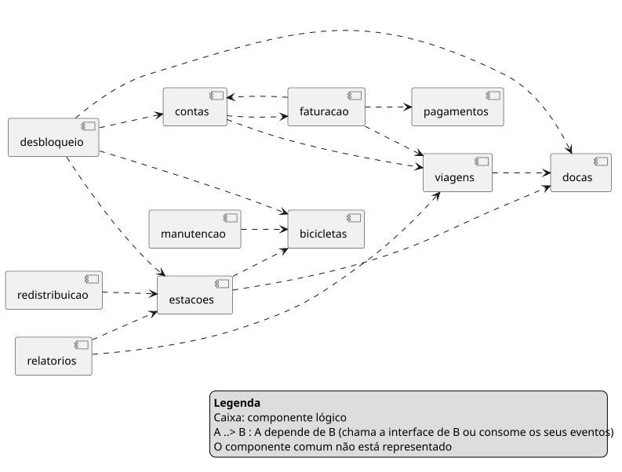
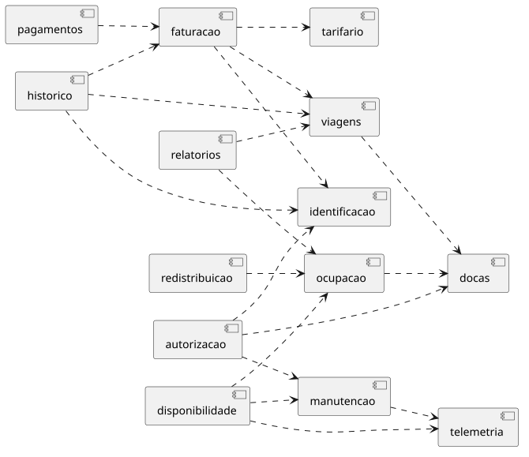

# 02 - Componentes 

Este documento tem como objetivo identificar os componentes lógicos, explicitar as abordagens de identificação, mapear User Stories aos componentes, analisar a coesão e o acoplamento e documentar a iteração de reestruturação fundamentada nas Top 3 Características Arquiteturais do documento [01](01-caracteristicas.md).

## 1. Ligação com as Top 3 características arquiteturais

1. C1 - Disponibilidade (Operacional/Implícita): Exige que o desbloqueio não dependa do backend, sendo decidido na doca a partir de informação previamente sincronizada. Exige também que os eventos reenviados pelas docas após falhas de rede sejam recebidos sem duplicar viagens nem cobranças, e que uma falha nos pagamentos nunca bloqueie a devolução de uma bicicleta.

2. C2 - Elasticidade (Operacional/Implícita): Exige separar a receção da telemetria (~35 msg/s vindas das 1 050 bicicletas elétricas, a cada 30s) do registo de viagens, e separar as consultas do mapa da atualização da ocupação das estações. Assim, nos momentos de pico (70% nas horas de ponta, ×4 em eventos), estes fluxos não competem pelos mesmos recursos.

3. C3 - Configurabilidade (Estrutural/Implícita): Exige isolar o cálculo do valor das viagens, guiado por configuração por município e separado da faturação e do ciclo de vida das viagens. Desta forma, câmaras municipais vizinhas podem ter tarifários próprios sem alterar a lógica central de negócio.

## 2. Identificação dos componentes

Temos duas abordagens para identificar os componentes do sistema:
- Workflow: decompor cada processo de negócio em passos e atribuir os passos a componentes.
- Actor/Action: decompor cada ator ou agente do sistema em responsabilidades e atribuir as responsabilidades a componentes.

Aplicámos as duas aos requisitos do enunciado e comparámo-las.

### 2.1. Workflow

| Req. | Passos (caminho feliz)                                                                                                                         | Componentes                                                           |
|------|------------------------------------------------------------------------------------------------------------------------------------------------|-----------------------------------------------------------------------|
| 1    | Identificar utilizador → validar elegibilidade → verificar bicicleta disponível → enviar comando à doca → receber confirmação → iniciar viagem | `desbloqueio`, `contas`, `estacoes`, `bicicletas`, `docas`, `viagens` |
| 2    | Doca confirma encaixe → fechar viagem → atualizar ocupação da estação                                                                          | `docas`, `viagens`, `estacoes`                                        |
| 3    | Obter viagem fechada → identificar tipo de utilizador → calcular valor → emitir fatura → cobrar                                                | `faturacao`, `viagens`, `contas`, `pagamentos`                        |
| 4    | Obter ocupação das estações → obter estado das bicicletas → apresentar mapa                                                                    | `estacoes`, `bicicletas`                                              |
| 5    | Receber reporte de avaria → marcar bicicleta indisponível → criar ordem → notificar técnico                                                    | `bicicletas`, `manutencao`                                            |
| 6    | Consultar ocupação → identificar desequilíbrios → calcular rotas → enviar às carrinhas                                                         | `redistribuicao`, `estacoes`                                          |
| 7    | Obter viagens do mês → agrupar por freguesia → calcular utilização e CO₂ evitado → produzir relatório                                          | `relatorios`, `viagens`, `estacoes`                                   |
| 8    | Autenticar utilizador → obter viagens → obter faturas → apresentar                                                                             | `contas`, `viagens`, `faturacao`                                      |

### 2.2. Actor/Action

| Ator                     | Ação                                                        | Req. | Componente                  |
|--------------------------|-------------------------------------------------------------|:----:|-----------------------------|
| Assinante                | Desbloquear com a app (QR) ou com o cartão Navegante        |  1   | `desbloqueio`               |
|                          | Pagar o excedente após os 45 min grátis                     |  3   | `faturacao`, `pagamentos`   |
| Ocasional                | Desbloquear e pagar a viagem (MB WAY ou cartão)             | 1, 3 | `desbloqueio`, `pagamentos` |
| Assinante / Ocasional    | Devolver a bicicleta numa doca livre                        |  2   | `docas`, `viagens`          |
|                          | Ver o mapa em tempo real                                    |  4   | `estacoes`                  |
|                          | Reportar uma avaria                                         |  5   | `bicicletas`                |
|                          | Consultar histórico de viagens e faturas                    |  8   | `contas`                    |
| Doca                     | Confirmar desbloqueio e encaixe                             | 1, 2 | `docas`                     |
|                          | Reenviar os eventos guardados (até 24h) quando a rede volta | US-3 | `docas`                     |
| Bicicleta                | Enviar telemetria a cada 30s em andamento                   | 4, 5 | `bicicletas`                |
|                          | Reportar avaria (bateria, travões)                          |  5   | `bicicletas`                |
| Técnico de manutenção    | Receber, aceitar e fechar ordens                            |  5   | `manutencao`                |
| Equipa de redistribuição | Receber rotas sugeridas                                     |  6   | `redistribuicao`            |
| Gestor municipal         | Obter o relatório mensal por freguesia                      |  7   | `relatorios`                |
| Sistema                  | Comunicar faturas à AT e garantir o arquivo de 10 anos      |  3   | `faturacao`                 |
|                          | Publicar a ocupação como dados abertos (dentro de 1 ano)    |  —   | `relatorios`                |

### 2.3. Comparação e escolha

| Critério                              | Workflow                                                                |               Actor/Action               |
|---------------------------------------|-------------------------------------------------------------------------|:----------------------------------------:|
| Doca e bicicleta                      | Aparecem só como passos de processos de pessoas ("receber confirmação") | Aparecem como atores, com ações próprias |
| Reenvio de eventos após falha de rede | Não aparece: o caminho feliz assume rede disponível                     |        Aparece como ação da doca         |
| Telemetria a cada 30s                 | Não aparece em nenhum processo                                          |      Aparece como ação da bicicleta      |
| Tarefas sem utilizador                | Escondidas dentro de outros passos                                      |      Aparecem como ações do sistema      |
| Ordem das operações entre componentes | Explícita                                                               |               Não aparece                |

Ao fazer a comparação, concluímos que o Actor/Action é a abordagem mais adequada. O Workflow segue o caminho feliz dos processos das pessoas e, por isso, esconde responsabilidades críticas: o reenvio de eventos pelas docas após falhas de rede (C1), a telemetria das bicicletas (C2) e as tarefas sem utilizador, como a comunicação à AT. O Actor/Action trata a doca, a bicicleta e o sistema como atores, o que faz estas responsabilidades aparecerem logo na primeira decomposição.

## 3. Análise da primeira iteração

### 3.1. Coesão

| Componente       | Nível          | Justificação                                                                                      | Problema detetado                                                                                                                           |
|------------------|----------------|---------------------------------------------------------------------------------------------------|---------------------------------------------------------------------------------------------------------------------------------------------|
| `contas`         | Comunicacional | Autenticação, passes e histórico operam sobre os dados do utilizador                              | Agrupado por dados e não por ação (entity trap). Inclui a consulta de histórico e faturas, que obriga a depender de `viagens` e `faturacao` |
| `desbloqueio`    | Sequencial     | Valida o utilizador, verifica a bicicleta, envia o comando e espera a confirmação, por esta ordem | Coloca o backend no caminho crítico de cada desbloqueio, contrariando C1 e o ADR-001                                                        |
| `docas`          | Funcional      | Comunica com as docas: envia comandos e recebe eventos                                            | Não trata eventos reenviados ou fora de ordem: um reenvio cria viagens duplicadas (US-3)                                                    |
| `estacoes`       | Comunicacional | Topologia, ocupação e mapa operam sobre os dados das estações                                     | Mistura a escrita da ocupação com as leituras do mapa, que nos picos competem (C2)                                                          |
| `bicicletas`     | Comunicacional | Telemetria, avarias e estado operam sobre os dados da bicicleta                                   | Entity trap. Recebe o fluxo de maior volume do sistema (C2)                                                                                 |
| `viagens`        | Funcional      | Abre e fecha viagens                                                                              | —                                                                                                                                           |
| `faturacao`      | Sequencial     | Calcula o valor, emite a fatura, cobra e comunica à AT                                            | Contém as regras de preço (C3). Uma falha na cobrança interrompe a sequência                                                                |
| `pagamentos`     | Funcional      | Cobra uma fatura                                                                                  | —                                                                                                                                           |
| `manutencao`     | Funcional      | Gere ordens de manutenção                                                                         | —                                                                                                                                           |
| `redistribuicao` | Funcional      | Sugere rotas às carrinhas                                                                         | —                                                                                                                                           |
| `relatorios`     | Funcional      | Produz o relatório mensal                                                                         | —                                                                                                                                           |

### 3.2. Acoplamento e instabilidade

A depende de B (A → B) se A chama a interface de B ou consome eventos publicados por B. O componente `comum` (tipos partilhados) não entra nas contas.

*Diagrama de componentes UML ([fonte](diagramas/componentes-iteracao1.puml)). Uma seta tracejada A → B significa que A depende de B.*

| Componente       | Ce (depende de)                                 | Ca (dependem dele)                                |  I   | Problema detetado                                                                      |
|------------------|-------------------------------------------------|---------------------------------------------------|:----:|----------------------------------------------------------------------------------------|
| `docas`          | 0                                               | 3 (`desbloqueio`, `viagens`, `estacoes`)          | 0,00 | —                                                                                      |
| `bicicletas`     | 0                                               | 3 (`desbloqueio`, `estacoes`, `manutencao`)       | 0,00 | Muito estável, mas recebe o fluxo mais volátil em carga (telemetria)                   |
| `pagamentos`     | 0                                               | 1 (`faturacao`)                                   | 0,00 | —                                                                                      |
| `viagens`        | 1 (`docas`)                                     | 3 (`faturacao`, `contas`, `relatorios`)           | 0,25 | —                                                                                      |
| `estacoes`       | 2 (`docas`, `bicicletas`)                       | 3 (`desbloqueio`, `redistribuicao`, `relatorios`) | 0,40 | —                                                                                      |
| `contas`         | 2 (`viagens`, `faturacao`)                      | 2 (`desbloqueio`, `faturacao`)                    | 0,50 | Ciclo `contas ↔ faturacao`. A identidade devia ser das partes mais estáveis do sistema |
| `faturacao`      | 3 (`viagens`, `contas`, `pagamentos`)           | 1 (`contas`)                                      | 0,75 | Ciclo `faturacao ↔ contas`. Depende de `pagamentos` de forma síncrona                  |
| `desbloqueio`    | 4 (`contas`, `estacoes`, `bicicletas`, `docas`) | 0                                                 | 1,00 | Ce mais alto do sistema, num caminho síncrono e crítico                                |
| `manutencao`     | 1 (`bicicletas`)                                | 0                                                 | 1,00 | —                                                                                      |
| `redistribuicao` | 1 (`estacoes`)                                  | 0                                                 | 1,00 | —                                                                                      |
| `relatorios`     | 2 (`viagens`, `estacoes`)                       | 0                                                 | 1,00 | —                                                                                      |

## 4. Iteração de reestruturação

Decidimos fazer uma iteração de reestruturação dos componentes, com base na análise da coesão e do acoplamento, com 7 alterações (cada alteração corresponde a um problema 
detetado anteriormente):

| # | Problema na 1ª Iteração                                                 | Motivo                                                                                              | Alteração                                                                                                                           | Ligação           |
|:-:|-------------------------------------------------------------------------|-----------------------------------------------------------------------------------------------------|-------------------------------------------------------------------------------------------------------------------------------------|-------------------|
| 1 | `contas` agregava autenticação, passes e histórico                      | *Entity trap*, coesão só comunicacional e ciclo com `faturacao`                                     | Dividido em `identificacao` (autenticar e validar elegibilidade) e `historico` (consulta do próprio utilizador). O ciclo desaparece | Entity trap, RGPD |
| 2 | `desbloqueio` orquestrava o desbloqueio de forma síncrona               | Backend no caminho crítico e Ce = 4: uma falha de rede ou um pico impede desbloqueios e gera multas | Substituído por `autorizacao`: emite QR assinados e sincroniza com as docas a informação para decidirem sozinhas                    | C1, C2, ADR-001   |
| 3 | `docas` não tratava reenvios                                            | Um reenvio duplicava viagens e cobranças                                                            | `docas` passa a receber eventos de forma idempotente e ordenada por doca                                                            | C1, US-3, ADR-003 |
| 4 | `bicicletas` era um gestor da entidade bicicleta e recebia a telemetria | *Entity trap* e fluxo de alto volume num componente de que três dependem                            | Telemetria passa para `telemetria`. O estado "fora de serviço" passa para `manutencao`. `bicicletas` deixa de existir               | C2, ADR-004       |
| 5 | `faturacao` continha as regras de preço                                 | Uma câmara nova obrigava a alterar um componente com obrigações legais                              | Regras de preço passam para `tarifario`, guiado por configuração                                                                    | C3, ADR-005       |
| 6 | `faturacao` cobrava de forma síncrona                                   | Uma falha no pagamento interrompia a emissão da fatura                                              | Dependência invertida: `pagamentos` reage à fatura emitida, de forma assíncrona                                                     | C1, ADR-006       |
| 7 | `estacoes` servia a escrita da ocupação e as leituras do mapa           | Nos picos as leituras do mapa competem com as atualizações                                          | Dividido em `ocupacao` (escrita) e `disponibilidade` (vista de leitura do mapa, base futura dos dados abertos)                      | C2                |

## 5. Componentes finais

| Componente        | Responsabilidade                                                                                 | Origem                    |
|-------------------|--------------------------------------------------------------------------------------------------|---------------------------|
| `comum`           | Tipos partilhados (identificadores, `Montante` em cêntimos, eventos base), sem lógica de negócio | —                         |
| `identificacao`   | Autentica o utilizador (app ou Navegante) e indica se é elegível para desbloquear                | Alteração 1               |
| `autorizacao`     | Emite QR assinados e mantém nas docas a informação para decidirem o desbloqueio localmente       | Alteração 2               |
| `docas`           | Recebe os eventos das docas sem duplicados e por ordem, e envia-lhes as sincronizações           | Alteração 3               |
| `viagens`         | Abre a viagem no desbloqueio e fecha-a no encaixe, calculando a duração                          | —                         |
| `ocupacao`        | Mantém as docas livres e ocupadas de cada estação e a topologia (freguesia, nº de docas)         | Alteração 7               |
| `disponibilidade` | Vista de leitura do mapa: bicicletas e docas livres por estação                                  | Alteração 7               |
| `telemetria`      | Recebe a telemetria das elétricas, guarda o último estado e deteta avarias                       | Alteração 4               |
| `manutencao`      | Abre ordens de manutenção, marca bicicletas fora de serviço e notifica os técnicos               | Alteração 4               |
| `tarifario`       | Calcula o valor de uma viagem segundo o tarifário configurado do município                       | Alteração 5               |
| `faturacao`       | Emite a fatura com numeração sequencial, comunica-a à AT e garante o arquivo de 10 anos          | Alteração 5 e Alteração 6 |
| `pagamentos`      | Cobra a fatura pelo meio do utilizador (simulado)                                                | Alteração 6               |
| `historico`       | Devolve ao próprio utilizador as suas viagens e faturas                                          | Alteração 1               |
| `redistribuicao`  | Identifica desequilíbrios de ocupação e sugere rotas às carrinhas                                | —                         |
| `relatorios`      | Produz o relatório mensal por freguesia (utilização e CO₂ evitado)                               | —                         |

Apesar do nome, `viagens` não é uma entity trap: a sua responsabilidade é um processo (abrir no desbloqueio, fechar no encaixe e calcular a duração), não operações CRUD. A consulta de viagens passou para `historico`.

## 6. Mapeamento para user stories

Decidimos mapear os componentes finais para as US-1, US-2 e US-3.

| User story                                                                                  | Ator      | Componentes                                                                                            | Nº |
|---------------------------------------------------------------------------------------------|-----------|--------------------------------------------------------------------------------------------------------|:--:|
| US-1 (obrigatória): desbloqueio e devolvo uma bicicleta e a viagem fica registada e cobrada | Assinante | `identificacao`, `autorizacao`, `docas`, `viagens`, `ocupacao`, `tarifario`, `faturacao`, `pagamentos` | 8  |
| US-2: recebo uma ordem de manutenção quando uma bicicleta reporta avaria                    | Técnico   | `telemetria`, `manutencao`, `autorizacao` (a bicicleta deixa de poder ser desbloqueada)                | 3  |
| US-3: reenvio os eventos guardados quando a rede volta, sem duplicar viagens                | Doca      | `docas`, `viagens`, `ocupacao`                                                                         | 3  |

## 7. Análise dos componentes finais

### 7.1. Coesão

| Componente        | Nível          | Justificação                                                                                                                                                                                         |
|-------------------|----------------|------------------------------------------------------------------------------------------------------------------------------------------------------------------------------------------------------|
| `comum`           | Lógica         | Agrupa o que é partilhado (identificadores, `Montante`, eventos base), não uma função. Aceitável só porque não tem lógica de negócio. Regra: nada entra em `comum` se for usado por um só componente |
| `identificacao`   | Comunicacional | Autenticar o utilizador e validar a elegibilidade são funções distintas que operam sobre os mesmos dados da conta                                                                                    |
| `autorizacao`     | Funcional      | Tudo serve um único objetivo: permitir que a doca decida o desbloqueio sozinha (QR assinados e sincronização)                                                                                        |
| `docas`           | Funcional      | Só trata da comunicação fiável com as docas: receber eventos sem duplicados e por ordem, e enviar sincronizações                                                                                     |
| `viagens`         | Funcional      | Só gere o ciclo de vida de uma viagem: abrir no desbloqueio e fechar no encaixe                                                                                                                      |
| `ocupacao`        | Funcional      | Só mantém o estado das docas livres e ocupadas de cada estação                                                                                                                                       |
| `disponibilidade` | Funcional      | Só compõe a vista de leitura do mapa em tempo real                                                                                                                                                   |
| `telemetria`      | Funcional      | Só recebe a telemetria das bicicletas e deteta avarias a partir dela                                                                                                                                 |
| `manutencao`      | Funcional      | Só gere o ciclo de uma ordem de manutenção, incluindo a bicicleta ficar fora de serviço                                                                                                              |
| `tarifario`       | Funcional      | Função pura: a partir da duração, tipo de utilizador e município, calcula o valor                                                                                                                    |
| `faturacao`       | Sequencial     | Cada passo usa o resultado do anterior: valor → fatura numerada → comunicação à AT                                                                                                                   |
| `pagamentos`      | Funcional      | Só cobra uma fatura pelo meio de pagamento do utilizador                                                                                                                                             |
| `historico`       | Funcional      | Só responde a consultas do próprio utilizador sobre as suas viagens e faturas                                                                                                                        |
| `redistribuicao`  | Funcional      | Só calcula sugestões de rota para equilibrar a ocupação das estações                                                                                                                                 |
| `relatorios`      | Funcional      | Só agrega dados de utilização para o relatório mensal da Câmara                                                                                                                                      |

### 7.2. Acoplamento e instabilidade

*Diagrama de componentes UML ([fonte](diagramas/componentes-iteracao2.puml)). Uma seta tracejada A → B significa que A depende de B. `comum` não está representado.*

| Componente        | Ce (depende de)                             | Ca (dependem dele)                                    |  I   |
|-------------------|---------------------------------------------|-------------------------------------------------------|:----:|
| `identificacao`   | 0                                           | 3 (`autorizacao`, `faturacao`, `historico`)           | 0,00 |
| `docas`           | 0                                           | 3 (`autorizacao`, `viagens`, `ocupacao`)              | 0,00 |
| `telemetria`      | 0                                           | 2 (`manutencao`, `disponibilidade`)                   | 0,00 |
| `tarifario`       | 0                                           | 1 (`faturacao`)                                       | 0,00 |
| `viagens`         | 1 (`docas`)                                 | 3 (`faturacao`, `historico`, `relatorios`)            | 0,25 |
| `ocupacao`        | 1 (`docas`)                                 | 3 (`disponibilidade`, `redistribuicao`, `relatorios`) | 0,25 |
| `manutencao`      | 1 (`telemetria`)                            | 2 (`autorizacao`, `disponibilidade`)                  | 0,33 |
| `faturacao`       | 3 (`viagens`, `tarifario`, `identificacao`) | 2 (`pagamentos`, `historico`)                         | 0,60 |
| `autorizacao`     | 3 (`identificacao`, `manutencao`, `docas`)  | 0                                                     | 1,00 |
| `disponibilidade` | 3 (`ocupacao`, `telemetria`, `manutencao`)  | 0                                                     | 1,00 |
| `historico`       | 3 (`viagens`, `faturacao`, `identificacao`) | 0                                                     | 1,00 |
| `relatorios`      | 2 (`viagens`, `ocupacao`)                   | 0                                                     | 1,00 |
| `pagamentos`      | 1 (`faturacao`)                             | 0                                                     | 1,00 |
| `redistribuicao`  | 1 (`ocupacao`)                              | 0                                                     | 1,00 |

## 8. Acoplamento Temporal

### 8.1. Fechar e cobrar uma viagem (US-1)

Ordem de ações: encaixe confirmado -> terminar viagem -> calcular valor -> emitir fatura -> cobrar

- Numa única unidade de trabalho: terminar a viagem e registar o evento de viagem fechada. Ou acontecem os dois, ou não acontece nenhum.
- Fora da unidade de trabalho: calcular o valor, emitir a fatura e cobrar acontecem de forma assíncrona. Se o pagamento falhar, a viagem fica como terminada, e nunca é reaberta ([ADR-006](adr/ADR-006.md)).

### 8.2. Reenvio de eventos (US-3)

Ordem de ações: guardar o evento e a sua chave (doca, nº de sequência) -> confirmar a receção à doca -> aplicar os eventos por ordem de sequência

- Numa única unidade de trabalho: guardar o evento e a sua chave. Só depois é que se confirma à doca, caso fosse antes, a doca apagaria o evento e perdia-se a informação ([ADR-003](adr/ADR-003.md)).
- Ordem entre eventos: na mesma doca, o encaixe de uma viagem nunca é aplicado antes do desbloqueio.